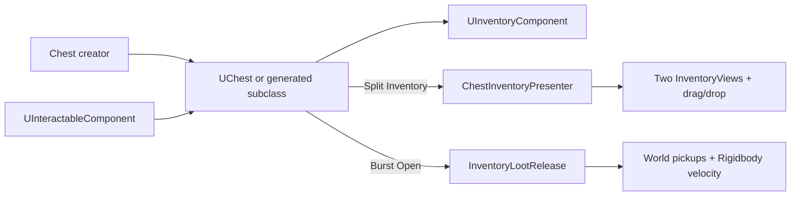
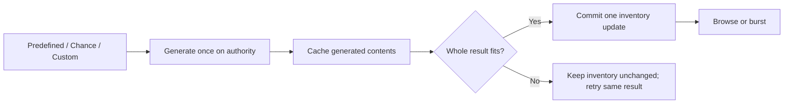

# Chest creator

Open **Tools > UnscriptedEngine > Inventory > Create Chest**. Requires the uGUI integration.

1. Enter chest **Name** and **Prototype** (script namespace). Select **Output folder** by dragging a Project folder into the field, using its picker, or clicking **Browse folder...**, matching scene/controller setup.
2. Enable **Extend Script** for an attached subclass of `UChest`; leave disabled to use the base directly.
3. Choose **Split Inventory** or **Burst Open**, capacity, and optional scene placement.
4. Choose **Contents Mode**: Predefined, Chance, or Custom (details below).
5. Click **Create Chest**. Generated subclasses compile first; prefab creation then resumes. Use **Finish Pending Chest** after fixing compilation errors. Cancel retains generated files.

Output: `<Output folder>/Chest_<Name>/`. Folder defaults to `Assets/Prototypes`; choose an existing runtime folder inside Assets, outside Editor and Resources. Existing outputs are never overwritten. Scene placement supports Undo; generated assets remain.



## Use

Replace the cube visual; retain a collider reachable by your interactor. Both variants include inventory, interaction and network root. Configure contents in the creator or the prefab's **UChest > Contents** Inspector. They populate on first open, on server/offline authority. An empty Predefined list creates an empty chest.

### Choose contents

| Mode | Configure | Example |
| --- | --- | --- |
| Predefined | Add item assets and exact quantities to Predefined Items. | Always 3 potions and 20 coins. |
| Chance | Create **Assets > Create > UnscriptedEngine > Inventory > Chest Loot Table**, add entries, assign Loot Table. | Coins 100%, potion 35%, sword 5%. |
| Custom | Assign a `ChestLootProvider` asset, or enable Extend Script and implement its generated `GenerateContents` hook. | Rewards based on quest, biome, player level or external service results. |

Chance entries roll **independently once**. Set minimum/maximum quantities (both inclusive). 100% guarantees an entry; 0% excludes it. Multiple entries may succeed, or all may fail. This is not a weighted "choose exactly one" table. Duplicate item definitions combine before insertion.



Reopening, disabling/enabling, or emptying a chest does not regenerate contents. A batch that cannot fit adds nothing; correct capacity and retry without rerolling. Existing inventory items count against capacity.

To prepare early, call once from your authoritative spawn/setup logic. Pass interactor context if a custom recipe needs it:

```csharp
if (!chest.TryInitializeContents(playerObject, out string error))
    Debug.LogWarning(error);
```

You can still add items manually after initialization:

```csharp
chest.Inventory.Initialize();
UInventoryComponent.OperationResult result = chest.Inventory.TryAddItem(potion, 3);
if (!result.Success) Debug.LogWarning(result.Message);
```

Use the framework interactor normally. Direct `chest.TryOpen(playerObject)` is also available after your own access validation.

- **Split:** generated child Canvas starts hidden. Presenter finds interactor's child inventory and opens player/chest grids. Close button hides it. Scene needs EventSystem with matching input module and TMP font resources. Your game must release cursor and suspend look/movement while browsing; creator does not change global input state.
- **Burst:** drop fragments need valid world pickup prefabs. Add Rigidbody/Collider for physical loot. Origin is above the placeholder cube. Each successful interaction releases up to the configured pickup cap; remaining contents stay stored. Empty or failed release does not report a successful open.

## Extend

Generated subclass uses `UnscriptedEngine.Prototypes.<Prototype>`. Hooks also work in manually authored subclasses:

```csharp
public class LockedChest : UChest
{
    protected override bool CanOpen(GameObject interactor)
    {
        return base.CanOpen(interactor) && HasRequiredKey(interactor);
    }

    protected override void OnOpened(GameObject interactor)
    {
        base.OnOpened(interactor);
        // Play lid animation, sound, or quest feedback.
    }

    private bool HasRequiredKey(GameObject interactor)
    {
        // Replace with your game's key lookup.
        return interactor != null;
    }
}
```

Use inspector **On Opened** for effects without a subclass. `InventoryOpenRequested` separates core storage from UI; custom presenters can subscribe/unsubscribe while enabled. Preserve base calls when overriding lifecycle methods. No new static runtime state is introduced.

### Custom recipe asset

Provider assets are shared: append item results and keep per-chest state out of the asset. Generation is synchronous; fetch asynchronous data before opening, then expose it to your provider/subclass.

```csharp
using System.Collections.Generic;
using UnityEngine;
using UnscriptedEngine;

namespace UnscriptedEngine.Prototypes.Example
{
    [CreateAssetMenu(menuName = "Example/Quest Chest Loot")]
    public sealed class QuestChestLoot : ChestLootProvider
    {
        [SerializeField]
        [Tooltip("Reward chosen by this recipe.")]
        private ItemDataSO reward;

        public override void Generate(UChest chest, GameObject interactor,
            List<InventorySlot> output)
        {
            // Replace with quest/level rules. Do not mutate chest.Inventory here.
            output.Add(new InventorySlot(reward, 2));
        }
    }
}
```

Without a provider, **Custom + Extend Script** generates an empty `GenerateContents` override for your code. Append `InventorySlot` results there. Leaving it empty intentionally produces no loot.

## Limits

- UI creator needs uGUI; `UChest` itself has no UI dependency. Placeholder visual only; no lid rig, animation, automatic destruction, or lock/key system.
- Successful split request means presentation was requested; a presenter may reject a missing player inventory. On Opened may run on observing clients; keep authoritative rewards server-side.
- Local presenter shows UI only for the owning network interactor. Generic remote transfers still require your validated `TransferRequested` RPC adapter. Enforce server access/range/locks there too; a presentation hook is not authorization.
- Register chest/pickup prefabs for runtime network spawning. Pickup motion needs network physics/transform components. Persistence remains game-specific.
- Network UI may briefly show empty contents until the authoritative content snapshot arrives. Client peers never roll or insert loot.
- Generation state/cache belongs to the runtime chest instance and is not saved automatically. Recreated/pooled containers need a deliberate persistence/restock policy; disabling alone does not restock.
- Invalid provider output or exceptions stop generation for that instance; no partial rewards or repeated rolls. Fix configuration and recreate the instance. Capacity/catalog failures retain generated contents for retry.
- Chance uses Unity's random stream, with no per-chest seed control. Weighted selection, guaranteed minimum reward counts, async generation and loot previews remain custom-provider features.
- Repeated burst interactions release leftovers. Decide when to remove the chest; do not destroy it while contents remain unless intentional.
- Pending creation survives assembly reload in this Editor session, not Editor shutdown. Generated scripts under custom assembly definitions need a reference to `UnscriptedEngine`.
- Each chest gets its own inactive panel. Share a scene panel via presenter reference for many containers. Grid refresh and per-pickup replication costs remain; see [containers guide](InventoryContainers.md).
