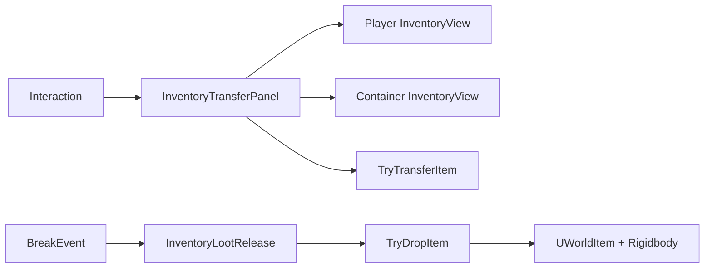
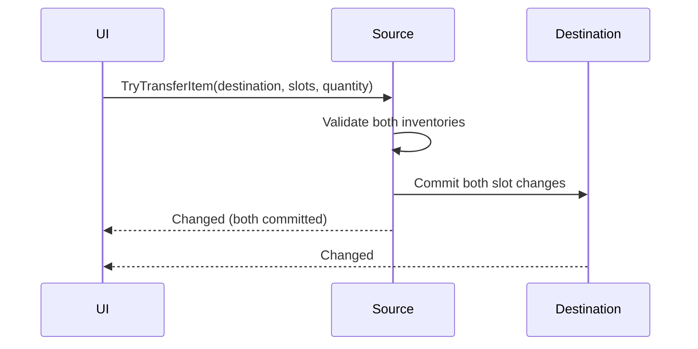

# Containers, transfers and loot

For prefab generation and the extensible chest base, see [Chest creator](ChestCreator.md).

Player bags, chests, corpses and crates all use `UInventoryComponent`. Storage knows nothing about chest animations or UI. Optional components compose those behaviours.



## Side-by-side setup

1. Add `UInventoryComponent` to player and chest. Configure slot counts. Initialize before adding starting contents.
2. Create a Canvas panel with two `InventoryView` objects laid out horizontally. Assign each view's grid, slot prefab and optional count text.
3. Slot prefab root needs `InventorySlotView` and a raycastable UI Graphic (for example Image). Scene needs EventSystem and Canvas GraphicRaycaster. Drag handlers are installed automatically on slot roots.
4. Add `InventoryTransferPanel`; assign both views. Open from your interaction code; call `Close()` when finished or out of range.

```csharp
playerInventory.Initialize();
chestInventory.Initialize();
chestInventory.TryAddItem(potion, 3); // Seed once, not every time opened.
panel.Open(playerInventory, chestInventory);
// Later:
panel.Close();
```

For gameplay input blocking, show `InventoryTransferPanel` as a managed modal screen: `uiController.Show(panelTemplate, screen => screen.Open(playerInventory, chestInventory));`. Chest presenter does this automatically using the interactor's existing `UCanvasController`. Calling `Open` directly on an unmanaged panel binds its views but does not register it with EventBus routing or acquire modal focus.

Drag moves the whole stack with a cursor-following slot preview. Empty target moves; matching target merges if the full amount fits; different item swaps whole stacks. Standalone `InventoryView` also supports rearrangement when bound to `UInventoryComponent`, without a transfer panel. Contents changed during dragging cancel the drop when detected. Preview never blocks target raycasts.

Generated chest UI and the project's default inventory prefabs use square, sharp-cornered cells on a black background. Older generated chest prefabs retain their saved layout; regenerate their panel or adjust its grid cell size and Images to match.

## Transfers without UI

```csharp
// Move two items to an exact slot, preserving the remainder.
UInventoryComponent.OperationResult result =
    chestInventory.TryTransferItem(0, playerInventory, 4, quantity: 2);
if (!result.Success) Debug.LogWarning(result.Message);
```

Invalid indices, quantities, stack overflow and singular-item violations leave both inventories unchanged. Partial swaps are rejected. Both inventories commit before `Changed` fires; callbacks cannot mutate either inventory until notifications finish. Transfers emit `EB_InventoryChanged`, not `EB_InventoryAddedItem`.



## Burst-open setup

1. Add `InventoryLootRelease` to chest. Assign inventory and optional spawn origin.
2. Each item needs `UItemFragDrop` with a valid `UWorldItem` prefab. Add Collider and Rigidbody to prefab for physical loot.
3. Connect interaction, animation or destruction event to `BurstOpen()`. Trigger before destroying the chest.
4. Set spawn radius beyond chest collider; place origin above the chest. Preview radius with selected-object gizmo.

```csharp
int spawned = lootRelease.Release();
// Destroy the chest only after your game has handled any remaining contents.
```

Default: one pickup per occupied stack, containing that stack's quantity. Enable Individual Items for separate objects. Maximum Pickups bounds each call; remainder stays stored. Outward/upward speed and spin set initial Rigidbody velocity. Missing Rigidbody still produces a collectible, without a launch. Failed spawn leaves that stack stored; other slots can still release. Release is synchronous and may partially succeed. Repeated calls release remaining contents, so enforce one-shot opening in your gameplay controller if needed.

## Extend

- **Random rewards:** use `UChest` Chance mode with `ChestLootTable`, or Custom mode with `ChestLootProvider`. Generation runs once; batch capacity failures keep the same roll. See [chest contents](ChestCreator.md#choose-contents).
- **Split controls:** use `panel.Transfer(source, sourceSlot, destination, targetSlot, quantity)` from your quantity selector. Built-in pointer dragging uses whole stacks.
- **Permissions:** validate locks, distance, ownership and session access before calling the transfer API. Core handles storage rules only.
- **Multiplayer:** assign `TransferRequested` to your network adapter. This replaces local execution. Send inventory network references, slots, quantity and expected contents; server validates sender access, distance and current contents, then calls `TryTransferItem`. Never trust references or quantities supplied by clients. Clear adapter on teardown.

```csharp
panel.TransferRequested = RequestValidatedTransfer;
// Adapter signature:
void RequestValidatedTransfer(UInventoryComponent source, int sourceSlot,
    UInventoryComponent destination, int targetSlot, int quantity)
{
    // Offline/server example. Remote clients must use your validated RPC here.
    UInventoryComponent.OperationResult result =
        source.TryTransferItem(sourceSlot, destination, targetSlot, quantity);
    if (!result.Success) Debug.LogWarning(result.Message);
}
// On adapter teardown:
panel.TransferRequested = null;
```

- **UI feedback:** subscribe to `TransferCompleted` for direct local results; unsubscribe when disabled. Network adapter supplies its own asynchronous result feedback.
- **Different presentation:** call transfer/release APIs from shops, gamepad menus or scripted events. No UI required.

## Limits and performance

- Server/offline mutations only. No built-in container transfer RPC, lock system, persistence or sample scene. Chest creator generates a panel; chance tables and custom providers supply loot.
- Network pickups require prefab registration. Add appropriate NetworkTransform/NetworkRigidbody components for remote physics presentation; spawned identity alone does not synchronize movement.
- Exact-slot merges are all-or-nothing; no automatic overflow distribution or partial acceptance. Item state remains definition plus quantity, without unique durability/instance metadata.
- Full inventory snapshots replicate per change. Each released pickup triggers its own inventory update. Keep burst caps modest for browsers; pooling, batched replication, timed release and active-physics budgets remain extension work.
- UI refresh scans slots on every change. Suitable for modest bags; very large grids may need changed-slot notifications and virtualization.
- No static drag state. Views unsubscribe while disabled; custom adapters must clean up their own subscriptions, including with domain reload disabled.
