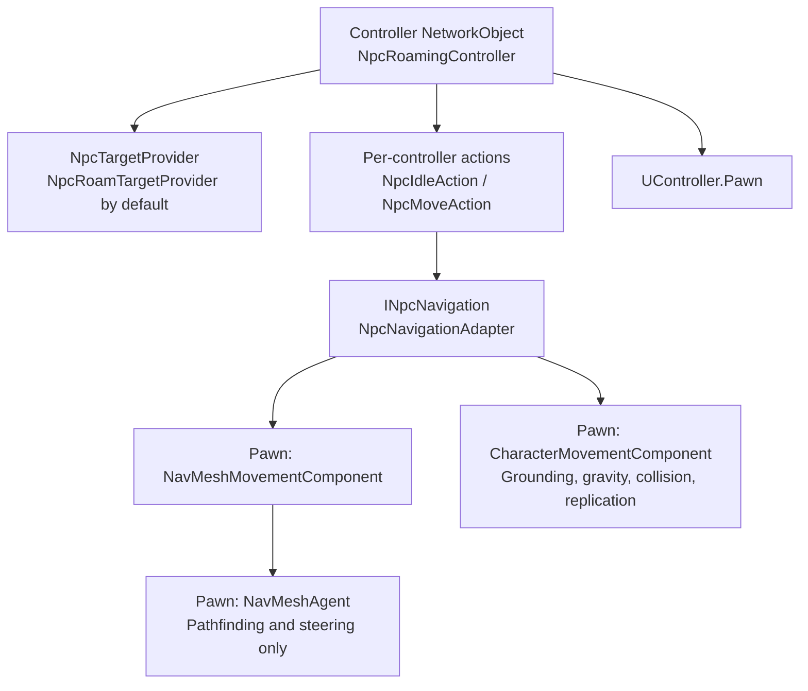
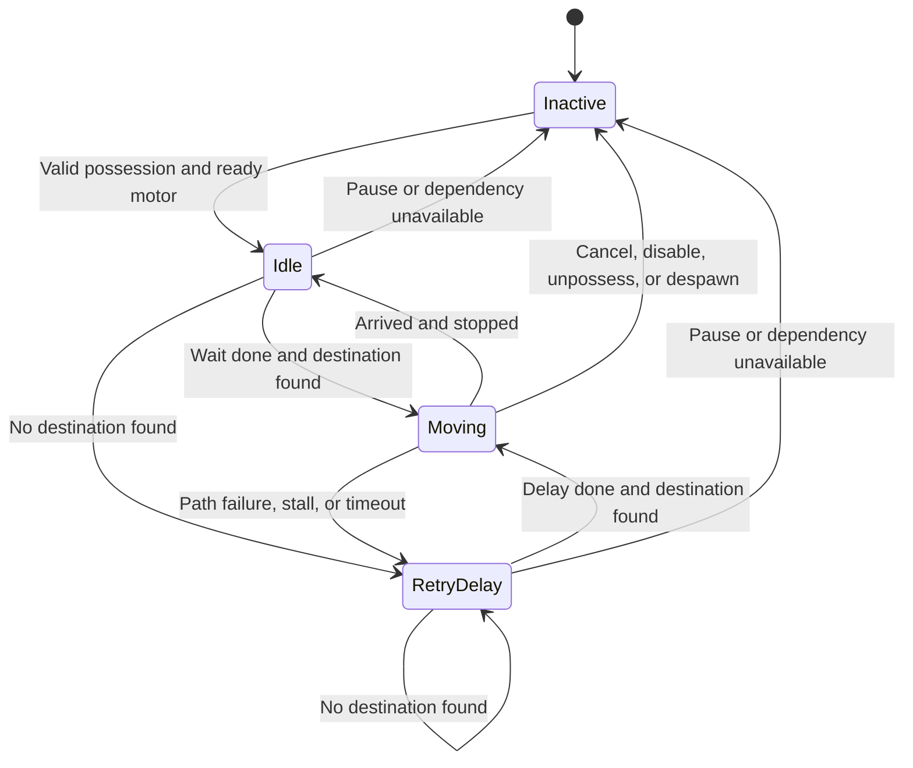
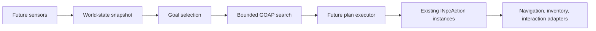

# Modular NPC roaming

This first AI slice alternates idle and grounded roaming. It runs on the server and reuses framework possession, managed updates, navigation, character simulation, and replication. It does not require a GOAP planner or a sensor framework.

## Components and ownership



The controller chooses when to move. The provider chooses where. The move action monitors completion and deadlines. The adapter feeds world-space steering to the existing character motor, with control yaw set to zero and body facing the steering direction. The NavMeshAgent does not move the transform independently.

Runtime actions belong to each controller. No shared mutable ScriptableObject state, static AI registry, coroutine, thread, or per-frame search allocation is introduced.

## Editor setup

1. Bake a walkable NavMesh using the project's AI Navigation package and a `NavMeshSurface`. Include the ground's collision geometry. Match the baked agent type to the NPC's `NavMeshAgent`.
2. Create a pawn prefab with a concrete `UPawn` subclass, a root `NetworkObject`, `CharacterMovementComponent`, `CharacterController`, `NavMeshAgent`, and `NavMeshMovementComponent` on the same root. Adding movement components supplies their required dependencies. Existing `P_NPCLuckyNumber` is a suitable concrete pawn class.
3. Keep flight disabled. Match the agent radius/height to the character collider and surface bake. Spawn on the NavMesh and above physical ground. Avoid overlapping NPC spawn positions.
4. Create a separate controller prefab with a root `NetworkObject`, `NpcRoamingController`, and `NpcRoamTargetProvider`. Assign the provider explicitly, or leave the reference empty to find a provider on that controller.
5. Register both prefabs in the active NetworkManager's prefab list. Spawn both on the server using `Spawn()` so the pawn stays server-owned. Possess the pawn after both objects spawn.
6. Run the project's normal game-instance/game-mode/game-state initialization. Framework `ServerFixedTick` and character simulation require their normal BeginPlay lifecycle; spawning NetworkObjects alone is insufficient.
7. Start a host or dedicated server. Observe idle, then movement and another idle. Remote clients display replicated character movement; they do not choose destinations.

Do not attach player-input movement drivers to this pawn. One system must own movement input. A roaming controller is a replacement for a player controller, not an additional controller on the same possession.

The Lucky Number prototype now provides an assembled example: `P_NPCLuckyNumber` spawns its assigned controller in server BeginPlay and removes it when the pawn despawns. For that configured prefab, spawn only the pawn; do not also spawn a controller using the generic example below. See `Assets/Prototypes/UnityGameJam2026/README.md` for scene wiring, operation, and future personality/GOAP guidance.

### Server spawn example

Call from your game mode or other server-side spawn workflow, after NetworkManager startup. `npcPawnPrefab` and `npcControllerPrefab` are registered prefab references. Spawn failures should be handled by the caller's existing spawn/cleanup policy.

```csharp
public static NpcRoamingController SpawnRoamer(
    UPawn npcPawnPrefab,
    NpcRoamingController npcControllerPrefab,
    Vector3 position)
{
    UPawn pawn = UnityEngine.Object.Instantiate(
        npcPawnPrefab, position, Quaternion.identity);
    pawn.NetworkObject.Spawn(); // Server ownership, not SpawnWithOwnership(clientId).

    NpcRoamingController controller = UnityEngine.Object.Instantiate(npcControllerPrefab);
    controller.NetworkObject.Spawn();
    controller.Possess(pawn);
    return controller;
}
```

The controller does not automatically spawn or destroy its pawn. Your game mode owns both lifetimes. Despawn both when removing an NPC.

## Configuration

| Component / setting | Default | Meaning |
| --- | --- | --- |
| Controller / Idle Duration | 1–3 s | Random wait before first movement and after successful arrival |
| Controller / Retry Delay | 2 s | Wait after target sampling or movement failure |
| Controller / Stopping Distance | 0.3 m | Arrival tolerance; navigation also waits for horizontal motor velocity to settle |
| Controller / Move Timeout | 30 s | Overall movement deadline, including path pending time |
| Controller / Stuck Timeout | 3 s | Deadline without sufficient horizontal displacement |
| Controller / Progress Distance | 0.15 m | Displacement needed to reset stuck timer |
| Controller / Home Anchor | none | Optional moving home reference; otherwise capture pawn position on possession |
| Provider / Radius | 10 m | Horizontal radius for candidate destinations around home |
| Provider / Sample Distance | 2 m | NavMesh projection distance and maximum target height difference from home |
| Provider / Minimum Travel | 1 m | Reject destinations too close to current position |
| Provider / Attempts | 4 | Maximum candidate samples/path checks per request; runtime capped at 16 |

The radius constrains destinations, not the whole route. NavMesh paths can detour outside the radius. The provider filters agent type and area mask, rejects projected targets outside the radius, and accepts only complete paths. Area costs influence the complete-path check through the query filter defaults; custom per-agent area-cost overrides are not copied into that filter. Multi-floor selection is limited by Sample Distance, not an explicit floor identifier.

For strict territory or floor restrictions, implement a provider with appropriate area masks and route validation. Avoid very large projection distances, which can select another floor or distant surface.

## Runtime workflow



Each fixed step:

1. Controller verifies possession, provider, server ownership, grounded movement mode, enabled components, and motor BeginPlay readiness.
2. At managed tick order **-60**, adapter reads navigation status and steering, writes motor input, then action checks completion/deadlines.
3. Character motor simulates at **-50**. Navigation synchronizes agent position at **-40**. The navigation input method also synchronizes before reading steering.
4. Completed actions transition once per step. There is no catch-up loop that can trigger repeated destination searches after a frame stall.

The initial idle spreads requests across time but is not a global budget. A large crowd can still produce coincident synchronous path searches.

### Operating an NPC

Use these methods from server game logic:

```csharp
controller.SetRoamingEnabled(false); // Cancel action and clear movement input immediately.
controller.SetHomePosition(new Vector3(20f, 0f, 15f));
controller.SetRoamingEnabled(true);  // Begin with a fresh idle on the next valid tick.

Debug.Log($"AI: {controller.State}; last move: {controller.LastMoveStatus}");

controller.UnPossess();             // Cancels movement before releasing the pawn.
controller.Possess(otherPawn);      // Rebinds adapters and captures the new home position.
```

`SetHomePosition` changes the fallback center; an assigned Home Anchor takes precedence. Changing home does not cancel an existing move. Pause and resume if immediate redirection is needed. State and LastMoveStatus are local diagnostics, not NetworkVariables; read authoritative values on the server. LastMoveStatus is null until the first movement starts for the bound pawn.

Disabling the controller cancels movement while retaining possession. Re-enabling starts a fresh idle. Disabled/despawned pawns and unavailable navigation are detected on the next server fixed tick. Controller disable, unpossess, despawn, and destroy cancel directly. Braking remains the motor's responsibility; clearing input does not teleport or instantly erase velocity.

All AI data is instance-owned. Disable/despawn clears active execution; respawn can rebind the retained possession. Normal project assumptions still apply: domain reload disabled, scene reload enabled. No AI event subscriptions or static state need resetting between sessions.

## Extending destinations: patrol example

Put this component on the controller, assign world-space patrol points, and assign it as Target Provider. This example delegates final reachability validation to movement, whose failure enters the normal retry delay. A production patrol provider can prevalidate routes or skip unavailable points.

```csharp
using UnscriptedEngine;
using UnityEngine;
using UnityEngine.AI;

public sealed class PatrolTargetProvider : NpcTargetProvider
{
    [SerializeField, Tooltip("World-space patrol destinations, visited in order.")]
    private Vector3[] points;
    private int nextPoint;

    public override bool TryGetDestination(
        Vector3 home, Vector3 current, NavMeshAgent agent, out Vector3 destination)
    {
        destination = current;
        if (points == null || points.Length == 0) return false;
        nextPoint %= points.Length;
        destination = points[nextPoint];
        nextPoint = (nextPoint + 1) % points.Length;
        return true;
    }
}
```

Providers may represent patrol routes, resource locations, cover points, or local territory. Keep sensing and game rules out of the motor. A provider only returns a destination; it should not start movement or retain another NPC's action state.

Providers can override `MovementFinished(NpcActionStatus status)` to commit route progress only after successful execution. Override `ContinueAfterArrival` to return true while following a continuous route; the controller then requests another destination without the usual idle interval. Defaults preserve ordinary roaming behavior. This skips deliberate idle time but retains the motor's braking and arrival checks.

The Lucky Number prototype uses this contract for roadside walking. GameMode injects one scene-owned route source into its NPCs, and a prototype-specific provider selects connected sidewalk/crossing nodes or delegates to the original roaming provider. Generic framework types never discover or depend on city-generation data. Full wiring and regeneration instructions are in `Assets/Prototypes/UnityGameJam2026/README.md`.

## Extending execution and adding GOAP later

`INpcAction` is a small execution contract. Configure an instance before `Start`, call `Tick` until terminal, and call `Cancel` when interrupted. Cancellation must release every resource the action owns. Do not tick an action after cancellation unless it has been restarted. Action instances are owned by one executor and reused, not shared across NPCs.

Example for a later interaction action:

```csharp
public sealed class InteractNpcAction : INpcAction
{
    private readonly System.Func<bool> tryInteract;
    private NpcActionStatus result;

    public InteractNpcAction(System.Func<bool> tryInteract)
    {
        this.tryInteract = tryInteract;
    }

    public void Start()
    {
        result = tryInteract() ? NpcActionStatus.Succeeded : NpcActionStatus.Failed;
    }

    public NpcActionStatus Tick(float deltaTime) => result;
    public void Cancel() { }
}
```

This example is for an atomic operation only. Timed interactions need explicit progress and cancellation. The callback should use authoritative interaction APIs and validate distance, target existence, and permissions.



When multiple goals are needed, replace the roaming coordinator with a plan executor and goal selection. Keep `NpcMoveAction`, `NpcIdleAction`, and `INpcNavigation`. The coordinator currently has private composition internals; inheriting it is not an action-registration mechanism. New decision policies should compose the actions in their own controller.

Sensors then feed per-NPC facts; a planner operates on snapshots and predicted effects. Gameplay execution confirms actual effects. Keep target binding and reservations in runtime action instances. Do not introduce planner facts into shared definition assets as mutable state.

## Debugging and verification

| Symptom | Check |
| --- | --- |
| Always Inactive | GameState initialized, controller/pawn spawned, correct possession, enabled provider, server-owned motor, flight off, motor BeginPlay |
| Always RetryDelay | Baked NavMesh, agent type/area mask, home inside reachable region, radius larger than minimum travel, sampling height |
| Moving then fails | Collision obstacles, motor lock, path completeness, timeout, stopping distance, stuck threshold |
| Moves in wrong direction | Another driver overwriting input/control yaw; adapter must own both |
| Moves but client state says Inactive | AI diagnostics are server-local; inspect host/server |
| Bumps against other NPCs | Spawn spacing, collider/agent radii, avoidance settings; stuck retry handles failure but is not crowd coordination |

`NpcActionTests` covers idle restart, negative delta time, rejected requests, terminal arrival, horizontal stuck detection, overall deadline despite movement progress, cancellation, restart, and navigation failure. Run in Unity's EditMode Test Runner under `UnscriptedEngine.Tests`.

Implementation validation: framework sources compile against this project's Unity references. All six action tests pass using a standalone Mono harness with the real action implementation and Unity/NUnit assemblies. This does not exercise Unity's player loop, Netcode code generation, NavMesh runtime, or scene serialization. The integration checks below still require the Editor and target build.

Manual integration checks:

- Host: idle, move, arrive, repeat; grounded motor remains collision authority.
- Block the route or lock the motor: movement fails and retries after the configured delay.
- Disable controller while moving: input clears; re-enable restarts with idle.
- Unpossess while moving, then possess a different server-owned pawn: old pawn stops; new home is captured.
- Disable/despawn pawn or controller; restart play twice with domain reload disabled: no old action resumes.
- Remote client: visible movement follows server; no client AI decisions.
- Web build: profile path-request spikes with expected NPC count.

Known limits: synchronous path checks, no global AI budget, no off-mesh-link traversal, no jumping/flying, no strict route containment, no perception/GOAP, no reservations, immediate steering-facing rotation, and no replicated animation/action label. Add only when required by gameplay.
