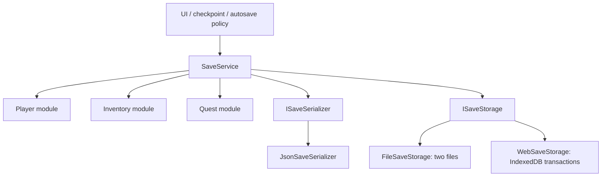
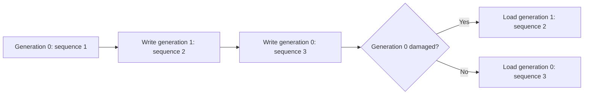

# Gameplay save system

`UnscriptedEngine.Saving` provides explicit feature modules, named slots, JSON serialization, corruption detection, and two-generation recovery. Native players and the Editor use files. Web players use IndexedDB directly and await transaction completion.

The service has no dependency on inventory, quests, scenes, UI, or networking. A game chooses what to save and when. Existing `SettingsRuntime` persistence stays independent.

## Architecture



| Piece | Owns | Does not own |
| --- | --- | --- |
| `SaveService` | Module registration, slots, envelope validation, generations, operation exclusion | Gameplay state, scene discovery, autosave timer |
| `ISaveModule` | Stable ID, version, capture, validation/migration, prepared restoration | Files, browser APIs, other feature modules |
| `ISaveSerializer` | Generic serialization/deserialization | Storage and gameplay |
| `ISaveStorage` | Read/write/delete persisted bytes | Interpreting feature payloads |

No process-wide mutable static state exists in this system. Create one service per owned save session; dispose browser storage and release module references when that session ends.

## Quick start

Import **Save Counter** through Package Manager > UnscriptedEngine > Samples. Attach `SaveCounterExample` to a GameObject. Connect UI buttons to `AddPoint`, `Save`, and `Load`. Save, stop Play, restart, then Load to verify persistence. In a Web build, save and refresh the page after the save completes.

For your own composition root:

```csharp
using System;
using UnscriptedEngine.Saving;

ISaveStorage storage = SaveStorage.CreateDefault(); // Unity main thread
SaveService saves = new SaveService(storage);
saves.Register(playerModule);     // Your ISaveModule implementation
saves.Register(inventoryModule);  // Your ISaveModule implementation

SaveResult result = await saves.SaveAsync("slot-1");
if (!result.Succeeded)
    UnityEngine.Debug.LogWarning($"Save failed: {result.Status}. {result.Error?.Message}");

// Before releasing the session: finish awaited operations, then release storage.
(storage as IDisposable)?.Dispose();
```

Keep `storage` and `saves` in private owner fields. Initialize them in an appropriate lifecycle method, such as `OnEnable`, and release them in `OnDisable`. Recreate the session on the next enable. Do not retain the service in an unreset static field when domain reload is disabled. The sample demonstrates this ownership pattern; disabling its GameObject during browser I/O reports failure through disposal.

Slot names contain 1–64 ASCII letters, digits, underscores, or hyphens. Names are case-sensitive in IndexedDB but may alias on case-insensitive filesystems; use lowercase consistently. Never pass a path as a slot name.

## Write a feature module

Use plain serializable data classes. Keep Unity object references in the module, outside saved data.

```csharp
using System;
using UnscriptedEngine.Saving;
using UnityEngine;

[Serializable]
public sealed class PlayerSaveData
{
    public Vector3 position;
    public int health;
}

public sealed class PlayerSaveModule : SaveModule<PlayerSaveData>
{
    private readonly Transform player;
    private readonly Func<int> readHealth;
    private readonly Action<int> writeHealth;
    private readonly Vector3 spawnPosition;

    public PlayerSaveModule(Transform player, Func<int> readHealth, Action<int> writeHealth)
    {
        this.player = player;
        this.readHealth = readHealth;
        this.writeHealth = writeHealth;
        spawnPosition = player.position;
    }

    public override string Id => "player";

    protected override PlayerSaveData Capture() => new PlayerSaveData
    {
        position = player.position,
        health = readHealth()
    };

    protected override PlayerSaveData CreateDefault() => new PlayerSaveData
    {
        position = spawnPosition,
        health = 100
    };

    protected override void Validate(PlayerSaveData data)
    {
        if (data.health < 0 || data.health > 100)
            throw new ArgumentException("Health is outside the supported range.");
    }

    protected override void Restore(PlayerSaveData data)
    {
        player.position = data.position;
        writeHealth(data.health);
    }
}
```

Register with `saves.Register(new PlayerSaveModule(playerTransform, () => health.Value, health.SetValue));`, adapting accessors to your health system. `playerTransform` and `health` are game-owned dependencies, not framework globals. For a Rigidbody or CharacterController, use your movement system's supported teleport operation instead of directly assigning its Transform.

Public data fields above are serialization records, not Inspector configuration. Any fields you expose on your own MonoBehaviours should remain private with `[SerializeField, Tooltip("...")]`.

Module IDs and versions must remain stable while registered. Duplicate IDs are rejected. Registration order defines capture, preparation, and application order. `Unregister(module)` removes a module from the session; its saved record is preserved as unknown data on subsequent saves.

## Save and load behavior

```mermaid
sequenceDiagram
    participant Game
    participant Service as SaveService
    participant Modules
    participant Storage
    Game->>Service: SaveAsync(slot)
    Service->>Storage: Read both generations
    Service->>Service: Validate hashes; choose newest valid snapshot
    Service->>Modules: Capture current data
    Service->>Service: Merge records; preserve unknown modules
    Service->>Storage: Write opposite generation
    Storage-->>Service: Write / IndexedDB transaction completes
    Service-->>Game: SaveResult
    Game->>Service: LoadAsync(slot)
    Service->>Storage: Read both generations
    Service->>Modules: PrepareRestore: decode, migrate, validate
    Note over Service,Modules: All modules must prepare before any apply
    Service->>Modules: Apply prepared actions in registration order
    Service-->>Game: SaveResult
```

`SaveAsync` always writes, even when `IsDirty` is false. It merges registered module captures into the selected slot's latest valid records. Unknown modules survive, including when a different service instance writes the slot. Saving another slot does not copy unknown data from a previously loaded slot.

`LoadAsync` first validates the envelope and record structure, then asks every registered module to prepare. `SaveModule<T>` decodes or creates defaults, validates, and returns an apply action. Preparation must not mutate gameplay. If preparation fails, no apply action runs. If an apply action throws, earlier actions may already have run: there is no gameplay rollback. Keep application simple and prevalidate dependencies.

A missing module in an existing slot uses `CreateDefault()`. A completely missing slot returns `NotFound` and leaves gameplay unchanged. Loading does not create objects, switch scenes, or resolve cross-feature references automatically. For dependent objects, register an object-creation module before modules that apply references; their preparation must defer reference resolution until application.

`DeleteAsync(slot)` removes both generations and does not reset gameplay. Native deletion can partially succeed if a filesystem operation fails; retry or inspect the result. IndexedDB deletes both keys in one transaction.

| Result | Meaning |
| --- | --- |
| `Success` | Operation completed; check `RecoveredFromCorruption` after load |
| `NotFound` | No generation exists; returned by load only |
| `Busy` | Another operation is running on this service; retry later |
| `Failed` | Inspect `Error`; dirty state is not acknowledged |

Concurrent requests return `Busy`; they are not queued or silently combined. Module registration changes throw while busy. Call all APIs on Unity's main thread and await operations. One storage/service owner must write a given slot; multiple services or browser tabs writing the same slot are not coordinated.

## Dirty tracking and autosaving

Call `MarkDirty()` when saved gameplay changes. It increments a revision; a successful save acknowledges the revision from when that save began. Changes marked during asynchronous I/O remain dirty. Load acknowledges the revision captured before applying prepared actions; if restore notifications call `MarkDirty`, the session remains dirty and may produce one redundant autosave.

Dirty tracking is a session-wide scheduling hint, not per-slot or per-module change tracking. Loading/saving another slot changes the session's acknowledged revision. Explicit saves should be used for Save As, even if `IsDirty` is false. Registration and deletion do not automatically mark state dirty.

Example checkpoint policy inside your owner:

```csharp
private async System.Threading.Tasks.Task SaveCheckpointAsync()
{
    if (saves.IsBusy || !saves.IsDirty) return;
    SaveResult result = await saves.SaveAsync("autosave");
    if (!result.Succeeded)
        UnityEngine.Debug.LogWarning(result.Error?.Message ?? result.Status.ToString());
}
```

Invoke from meaningful checkpoints or a modest unscaled-time interval. Subscribe to feature change events once and unsubscribe on shutdown. Avoid serializing in `Update`, saving on every inventory event, or stacking timers. The framework installs no timer and no quit handler.

## Generation files, corruption, and recovery

Native location: `Application.persistentDataPath/Saves/<slot>.0.save` and `<slot>.1.save`. Web storage uses two keys, `<slot>.0` and `<slot>.1`, in the `slots` object store.

Each outer envelope contains a positive sequence number, a Base64 SHA-256 hash, and a serialized document string. The hash covers the UTF-8 document, not the sequence number. The document contains `format: 1` and module records `{ id, version, payload }`. Payloads are serialized strings; the default JSON format escapes nested JSON.



Writes replace only the older generation. The last valid generation stays untouched during the next write. File writes are synchronous and not individually atomic; redundancy handles a truncated target file. This is not a filesystem power-loss guarantee or a backup against clearing both files.

If one generation is corrupt and another valid, load succeeds with `RecoveredFromCorruption == true`. This flag means a damaged generation was ignored; it does not imply the chosen data is older than that damaged generation. If both are invalid, operations fail without overwriting them. Preserve/export damaged data for diagnosis, then explicitly delete the slot if the user wants to start over.

Unknown outer document formats block saving/loading instead of falling back and overwriting a future format. Registered modules with a newer saved version also block saving. Unknown module records are preserved without attempting to understand them. Hashes detect accidental damage, not cheating or malicious edits; this is not encryption or authenticated storage.

## Browser behavior

`SaveStorage.CreateDefault()` selects `WebSaveStorage` only for `UNITY_WEBGL && !UNITY_EDITOR`. It creates a persistent callback GameObject with a unique name. The `.jslib` bridge opens IndexedDB, performs an operation, closes the connection, and reports completion or failure back to that instance. There are no persistent static callbacks to leak between Play sessions.

The database name defaults to `Application.companyName + "." + Application.productName + ".saves"`. Keep company/product values stable across builds. To choose an explicit stable name in a Web player, construct `WebSaveStorage.Create("my-game.saves")`. Browser storage is also scoped by origin and browser storage-partition rules; moving domains or changing embedding context may expose a different database.

This backend bypasses Unity's virtual filesystem, so it does not need `autoSyncPersistentDataPath` or manual filesystem flushing. Existing settings still use their original file path/store and are not migrated or made browser-durable by this feature. Unity documents its own persistent path as IndexedDB-backed: [Application.persistentDataPath](https://docs.unity3d.com/6000.4/Documentation/ScriptReference/Application-persistentDataPath.html).

Await save completion before showing a saved indicator or navigating away. Save checkpoints while playing; Web does not support `OnApplicationQuit`: [Unity lifecycle documentation](https://docs.unity3d.com/6000.4/Documentation/ScriptReference/MonoBehaviour.OnApplicationQuit.html). Closing a tab can interrupt pending work. The bridge has no timeout or cancellation API; dispose its owner to fail pending managed operations. Disposal cannot cancel an IndexedDB transaction that already started, so an operation reported as disposed may still persist.

Storage denial, quota exhaustion, transaction aborts, and blocked database upgrades return `Failed`. Browser data may be cleared, evicted, partitioned, or temporary in private sessions. Provide export/import or cloud storage if saves must survive those conditions; neither is built in. Only one writer per slot is supported, including across tabs.

Web data travels through the bridge as Base64, adding approximately one-third overhead plus temporary string copies. For small and medium prototype saves this keeps the adapter simple. Profile before using it for large worlds. A successful transaction is the browser's completion signal, not a guarantee against browser/OS loss of local storage.

## Migrate a module

Increment that module's `Version`; override `Decode` for older payloads. Keep the outer format unchanged for feature-only changes. Example within a `SaveModule<PlayerSaveData>` subclass:

```csharp
[Serializable]
private sealed class PlayerV1
{
    public Vector3 position;
    public int hitPoints;
}

public override int Version => 2;

protected override PlayerSaveData Decode(string payload, int version, ISaveSerializer serializer)
{
    if (version == 1)
    {
        PlayerV1 oldData = serializer.Deserialize<PlayerV1>(payload);
        return new PlayerSaveData { position = oldData.position, health = oldData.hitPoints };
    }
    return base.Decode(payload, version, serializer);
}
```

Validation runs after decoding. Migration happens in memory during load; the next successful save captures the current version. Unsupported module versions fail preparation without applying any module. Keep independent old-format fixture tests when changing field names or defaults. Renaming a module ID creates a different record; migrate IDs deliberately rather than silently abandoning the old key.

## Inventory and stable IDs

Persist definition IDs, slot indexes, quantities, and any per-instance item data. Never persist `GetInstanceID()` or direct `ItemDataSO` references. Existing `ItemDataSO.NetworkId` supplies an asset-GUID-based string; preserve `.meta` files so IDs survive moves. Resolve definitions through a game-owned catalog or `UnscriptedEngine.Item.ItemNetworkCatalog.Resolve(id)` when that generated catalog is available.

Example data shape:

```csharp
[Serializable]
public sealed class InventorySaveData
{
    public int capacity;
    public ItemSaveData[] items;
}

[Serializable]
public sealed class ItemSaveData
{
    public int slot;
    public string definitionId;
    public int quantity;
}
```

Capture `IInventory.Items` into that array using `InventorySlot.Item.NetworkId` and `InventorySlot.Quantity`. During preparation, validate IDs, slot bounds, quantities, stack rules, and duplicate slots. Resolve all definitions before modifying inventory. `UInventoryComponent` currently has no public atomic bulk-restore API; a production adapter should add a validated replacement operation rather than calling add/remove repeatedly and losing exact slot placement. This release includes a counter sample, not a built-in inventory adapter.

Catalog lookup currently scans definitions; resolving thousands of items individually may become a bottleneck. Build a dictionary once in your adapter if profiling warrants it. For multiplayer, save/restore authoritative server state; do not treat client-local records as authority. The framework does not serialize network object ownership or IDs.

## Extend storage and serialization

Implement `ISaveStorage` for cloud, console storage, encrypted files, or test doubles. `ReadAsync` returns null only when the generation is missing; throw on read failure. `WriteAsync` must affect only the requested generation and complete only when persistence has acknowledged it. `DeleteAsync` removes both generations. Validate slot names in externally accessible adapters too.

```csharp
public sealed class MemorySaveStorage : ISaveStorage
{
    private readonly System.Collections.Generic.Dictionary<string, byte[]> data =
        new System.Collections.Generic.Dictionary<string, byte[]>();

    public System.Threading.Tasks.Task<byte[]> ReadAsync(string slot, int generation)
    {
        byte[] value;
        bool found = data.TryGetValue(slot + "." + generation, out value);
        return System.Threading.Tasks.Task.FromResult(found ? (byte[])value.Clone() : null);
    }

    public System.Threading.Tasks.Task WriteAsync(string slot, int generation, byte[] value)
    {
        data[slot + "." + generation] = (byte[])value.Clone();
        return System.Threading.Tasks.Task.CompletedTask;
    }

    public System.Threading.Tasks.Task DeleteAsync(string slot)
    {
        data.Remove(slot + ".0");
        data.Remove(slot + ".1");
        return System.Threading.Tasks.Task.CompletedTask;
    }
}
```

The memory example is session-only and assumes trusted slot/generation arguments from `SaveService`; it is useful for testing. A cloud adapter additionally needs authentication, offline policy, conflict resolution, and access control. These are not supplied by the coordinator.

Implement `ISaveSerializer` to change encoding. Both the outer envelope/document and module payloads use it; return nonempty strings and support the framework's field-based serializable classes. Switching encoders changes the on-disk contract and requires migration or a different storage namespace. Unity JSON does not support dictionaries, polymorphic object graphs, properties, or arbitrary Unity object graphs as portable save data. Use DTO arrays/lists and explicit concrete types. For IL2CPP, preserve reflection-only types required by custom serializers and test a real Web build.

Compression/encryption can also decorate storage bytes while preserving the two-generation contract. Check decompression bounds and treat corrupt input as failure. Do not assume compression improves small saves.

## Performance and current limits

- Capture, JSON conversion, hashing, and native file I/O run on the calling main thread. Async APIs support browser/cloud waits; they do not make CPU work nonblocking.
- Every save reads and validates both generations, recaptures every registered module, and writes a full snapshot. No per-module incremental persistence, streaming, or zero-allocation guarantee.
- Nested JSON strings, Base64 on Web, hashes, DTOs, and restore-action closures allocate. Keep snapshots compact and checkpoint frequency modest.
- Module record matching uses linear list scans; intended for a modest number of feature modules. No scene-wide searches or reflection discovery run per save.
- No slot enumeration/metadata UI, screenshot capture, export/import, automatic scene loading, world spawning, autosave scheduler, cancellation, multi-writer locking, or cloud integration.
- No rollback after application begins. No arbitrary dependency graph or asynchronous module restoration. Prepare data without side effects; apply in explicit registration order.
- No configurable maximum document size. Never accept unbounded external/imported data without adding limits at the storage/serializer boundary.
- Settings and gameplay saving remain separate. No existing gameplay state becomes persistent until registered modules capture it.

## Verification

`Tests/Editor/SaveServiceTests.cs` covers persistence across storage instances, interrupted writes/recovery, checksum damage, unknown-module retention across service instances, slot separation/defaults, prepare-before-apply, overlapping requests, dirty changes during I/O, invalid slot names, missing slots, and deletion.

For standalone browser bridge checks, serve the package folder over localhost HTTP and open `Tests/Browser/SaveStorageBridge.html?phase=1`. After it reports 10 passing assertions, close/restart that browser with the same profile and open `?phase=2` on the same origin/port. Four more assertions verify persistence and deletion. The harness uses a dedicated `unscripted-save-validation` database; it tests the actual `.jslib` IndexedDB operations with an identity string-marshaling stub, not Unity's generated WebAssembly glue.

Implementation validation: C# sources, counter sample, and tests compile against Unity 6000.4.8f1 references for native and Web defines. Fourteen coordinator cases passed in a portable .NET harness using System.Text.Json in place of native Unity JSON. Fourteen browser assertions passed in headless Chrome, including restart persistence, abort recovery, and denied storage. Unity Test Runner could not execute because its licensing client connection failed; a built Unity Web player still needs integration validation.

Run EditMode tests in Unity Test Runner. For Web, test the built player on its actual host: save then refresh, two successive saves, missing slot, deletion, denied storage/quota failures, owner disposal, and stable deployment origin/database naming. Editor tests exercise file/memory storage; they do not prove browser integration or durability.
