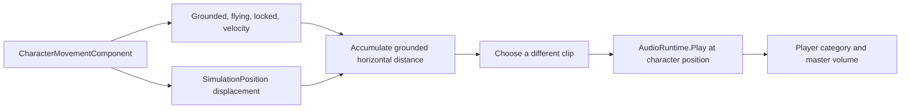

# Character footsteps 👣

## 🎯 What it does

`CharacterFootstepAudio` reads `CharacterMovementComponent` without changing movement simulation. It plays a random footstep every 1.8 horizontal metres while grounded, with no immediate clip repeats during continuous walking. Playback uses the shared **Player** category and master volume.

## 🛠️ How to use it

The sandbox `DefaultPawn` and game `P_PrototypeLuckyNumber` prefabs already have the component and all five clips from `Assets/GameAssets/Audio/Footsteps` assigned. Start a normal client/host game and walk. Adjust **General/Audio/Player volume** or master volume in settings.

For another character, add **Unscripted Engine > Audio > Character Footsteps** beside its movement component. Assign clips and choose `player` or `entities` as the category. Reduce **Step Distance** for quicker steps; adjust **Volume** for loudness. Enable **Debug/Show Gizmos** to see the configured stride distance when selected.

## ⚙️ How it works



Only clients play audio, including the host; dedicated servers stay silent. Each client observes movement locally, so there are no extra audio RPCs. Disabled movement, airborne/flying/locked state, idle movement, and large position jumps reset cadence. Render frames without a new fixed movement sample preserve accumulated distance. Actual displacement prevents footsteps while pressing into a wall. Each update emits at most one sound, avoiding catch-up bursts after a hitch.

## 🧩 How to extend it

Assign another clip set or category in the Inspector; the component has no dependency on these project assets. For footsteps driven by animation events or terrain materials, replace this component with a caller of the same shared audio API:

```csharp
AudioRuntime.Play(surfaceClip, AudioCategories.Player, 0.45f,
    position: transform.position);
```

See [shared audio](README.md) for category registration and pooled playback details.

## ⚠️ Limitations

Sounds are 3D and use the audio runtime's default attenuation. No surface detection, foot animation synchronization, landing sounds, or crouch-specific clips. Network corrections below the large-jump threshold can shift timing; steps are not synchronized exactly across clients. Moving platforms or external motion can contribute distance while grounded and moving. Remote replicas need valid grounded/movement state. Null clip entries skip a step; assign a complete set. Existing footstep tails finish after stopping or despawning. Browser autoplay restrictions and the shared 64-voice pool still apply.

Manual check: walk, vary speed, push into a wall, jump, fly, stop, and respawn. Check Player/master mute and host/client spatial playback. No per-frame allocations or physics queries are introduced by cadence tracking; allocations occur only when shared playback creates a voice handle.
