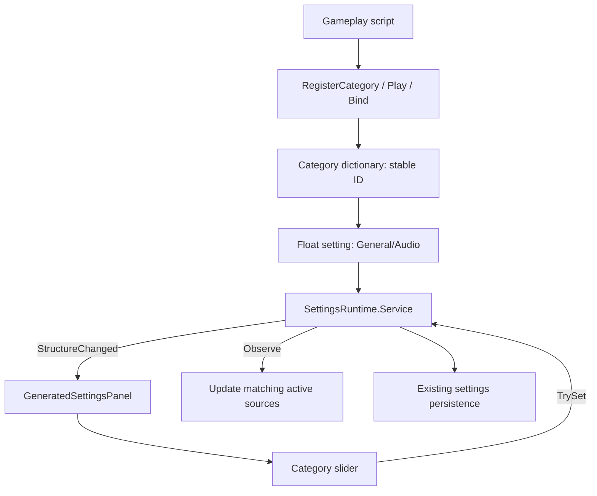
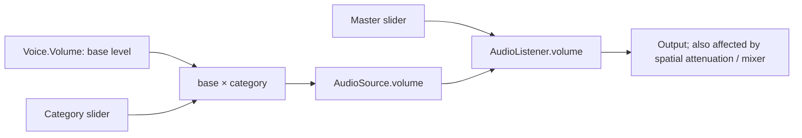

# 🔊 Shared audio

Any main-thread script can use `UnscriptedEngine.Audio.AudioRuntime`. No manager prefab, mixer asset, or `DefaultGameInstance` required. Runtime bootstraps before the first scene and survives scene changes.

## Quick start 🎮

```csharp
using UnscriptedEngine.Audio;
using UnityEngine;

// UI: 2D, fire-and-forget.
AudioRuntime.Play(clickClip, AudioCategories.UI);

// World sound: 3D, fixed position.
AudioRuntime.Play(impactClip, AudioCategories.Entities, 0.7f,
    position: transform.position);

// Keep a handle for loops. Stop when the owner no longer needs it.
AudioVoice ambience = AudioRuntime.Play(windClip, AudioCategories.Ambience,
    volume: 0.5f, loop: true);
ambience?.Stop();

// Settings changes immediately affect sounds already playing.
AudioRuntime.SetMasterVolume(0.8f);
AudioRuntime.SetCategoryVolume(AudioCategories.UI, 0.4f);
```

Missing clips or exhausted pool return `null`. Use null-safe handle access. A handle becomes invalid after a one-shot finishes or after `Stop`/`Dispose`; it never takes control of a reused source.

## Categories and sliders 🎚️

Built-in IDs: `ambience`, `ui`, `player`, `entities`, `misc`, `music`, `sound-effects`. Constants live in `AudioCategories`. All are registered at startup, so sliders exist before sounds play. Music defaults to 0.8; others and master default to 1.

`RegisterCategory`, `Play`, and `Bind` discover custom category IDs by explicit use. Registration creates a float setting under **General/Audio**. The existing `GeneratedSettingsPanel` observes settings structure changes and builds its slider. Add/open the project's normal settings UI to see it; the audio runtime does not create a Canvas or menu.



Categories remain registered until the play session ends. This avoids slider flicker when sounds stop or scenes change. Values persist through the existing `Settings.v2.json` store. Call `SettingsRuntime.Save()` if you need an explicit save point. Existing browser persistence constraints still apply; browser autoplay policies may require a user gesture before audio becomes audible.

Legacy `GeneralSettings.Audio` fields alias the framework's exact definition objects. Existing master/music/effects IDs and saved values remain compatible. Master now works without a scene General provider. Music and Sound Effects are independent categories; Sound Effects is **not** a parent multiplier for the other categories.

## Volume path



For base 0.5, category 0.4, master 0.8: level multiplier is `0.5 * 0.4 * 0.8 = 0.16`, before attenuation and any source mixer. Master is applied once by `AudioListener`, not multiplied into each source again. Values use linear amplitude, not decibels. Runtime sets managed sources' `ignoreListenerVolume` to false.

## Existing sources and moving emitters

Bind authored sources to preserve spatial settings, mixer routing, looping, pitch, and attachment to a moving object. Binding captures the current `AudioSource.volume` as the base level; it does not start playback. Keep using `source.Play()`/`Stop()` for that source, but change volume through the handle.

```csharp
using UnscriptedEngine.Audio;
using UnityEngine;

public sealed class EngineAudio : MonoBehaviour
{
    [SerializeField]
    [Tooltip("Authored looping engine source attached to this vehicle.")]
    private AudioSource engineSource;

    private AudioVoice engineVoice;

    private void OnEnable()
    {
        engineVoice = AudioRuntime.Bind(engineSource, AudioCategories.Entities);
        engineSource.Play();
    }

    public void SetThrottle(float throttle)
    {
        if (engineVoice != null) engineVoice.Volume = Mathf.Clamp01(throttle);
    }

    private void OnDisable()
    {
        engineVoice?.Dispose();
        engineVoice = null;
    }
}
```

Disposal stops an external source and restores its latest base volume. It does not destroy it. Duplicate binding throws; one source belongs to one category. Destroyed external sources are removed on the next runtime update. The project's rideable mount uses this binding for flight and engine audio.

## Extend with custom categories 🧩

```csharp
using UnscriptedEngine.Audio;
using UnscriptedEngine.Settings;

// Register before opening a menu when a custom label is wanted.
Setting<float> dialogue = AudioRuntime.RegisterCategory("dialogue", "Dialogue");
AudioRuntime.Play(speechClip, "dialogue");

// Or register implicitly on first playback:
AudioRuntime.Play(rainClip, "weather", loop: true);
```

IDs accept lowercase ASCII letters, digits, and hyphens. IDs are case sensitive and stable persistence keys. Custom setting ID is `general.audio.category.<id>`. First registration chooses the label; later calls reuse the same definition. Do not declare another setting with that ID: the settings service requires shared definition identity. Register custom categories each session, rather than keeping returned definitions in persistent static fields when domain reload is disabled.

For reusable libraries, expose category ID constants and register them from your own startup component. Add category hierarchy, fades, priorities, or mixer routing as separate policy layers rather than putting game-specific behavior into the shared service. Pooled `Play` intentionally has no raw source access; extend its API deliberately if authored pitch/rolloff is needed, or use `Bind` today.

## Lifecycle and performance

```mermaid
sequenceDiagram
    participant Unity
    participant Runtime as AudioRuntime
    participant Settings as SettingsRuntime
    participant Pool as AudioSource pool
    Unity->>Runtime: SubsystemRegistration
    Runtime->>Runtime: Dispose subscriptions; clear static state
    Unity->>Runtime: BeforeSceneLoad
    Runtime->>Settings: Register master + categories; observe values
    Unity->>Runtime: Play(clip, category)
    Runtime->>Pool: Reuse source or create under persistent driver
    Unity->>Runtime: Update
    Runtime->>Pool: Return finished one-shots
    Unity->>Runtime: Driver destroyed / session ends
    Runtime->>Settings: Dispose subscriptions and registrations
```

- Pool grows on demand up to **64 sources**, retained for the session. At capacity, new pooled requests return `null`; active sounds are not stolen.
- One update scans active handles for completion/destruction. No scene-wide source scans, per-source update components, or per-frame LINQ.
- Category changes scan active handles and update matching sources; master changes write one listener value.
- Each playback allocates a small handle. The pool avoids repeated GameObject/component creation but is not allocation-free.
- External bindings do not consume the pooled limit. Keep their number reasonable for browser builds.
- Static reset and subscription disposal support disabled domain reload. Always release long-lived handles from their owner's disable/destroy lifecycle.

## Limits and troubleshooting ⚠️

- Main thread and Play mode only. No audio-thread or background-thread API.
- An enabled Unity `AudioListener` is still required. The runtime never adds one.
- Unbound sources receive master volume unless they opt out, but receive no category control. Migrate them with `Bind` or replace playback with `Play`.
- Do not write managed `AudioSource.volume` directly: it bypasses category multiplication until the next update from the handle/category.
- Other code changing `AudioListener.volume` or `ignoreListenerVolume` can bypass this contract. Give shared runtime sole ownership of master volume.
- No automatic inference from clip names, tags, hierarchy, or mixer groups. Explicit category IDs keep routing predictable and avoid expensive scans.
- Pooled positional sounds stay at their starting world position, use Unity's default 3D attenuation, and persist across scene loads. Use bound sources for moving emitters or authored distances; stop persistent loops explicitly.
- No scheduled playback, per-voice pause, fades, crossfades, ducking, priority stealing, async asset loading, network replication, or category hierarchy. Global `AudioListener.pause` is supported: paused pooled voices are retained.
- One external source has one category, including all of its `PlayOneShot` sounds. Use separate sources/pooled calls for different categories.
- Setting/UI/store behavior remains owned by the existing settings framework. This feature creates definitions, not a new UI text implementation.

Manual check: open settings, play a looping voice, drag its category to zero, restore it, then drag master to zero. Verify another category is unaffected by the first slider. Register `dialogue` while the panel is open; verify its slider appears. Stop/re-enter Play mode twice with domain reload disabled; verify one runtime host and no duplicate sliders/subscriptions.
